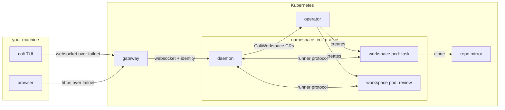

# Multi-user colinear

> **Design, not documentation.** Nothing here is built yet. This work happens on the `multi-user`
> branch, and pull requests for it target that branch, not `main`.

colinear today is one person's tool. A daemon on your machine (or a VM, or a container) dispatches
agents as you, with your credentials, and a TUI mirrors it. This set of documents describes
colinear as a **shared service**. It runs on a Kubernetes cluster, many people sign in, each gets
their own daemon, agents run in pods, and work can be shared.

Single-user mode is not being replaced. Everything here is additive, and `coli` on a laptop with
no cluster has to keep working exactly as it does now. Several pieces, the session runner most of
all, make single-user mode better on their own.

## Goals

- colinear can be **deployed on shared infrastructure** (a Helm chart and an operator) and **manage
  that infrastructure**: it spins up pods for code work, reviews and plans.
- **Many users, isolated by default.** Nobody sees another user's sessions or work unless it was
  shared with them.
- **Sharing.** A piece of work (a task, review or plan, with every agent session it has had) can
  be shared with named people or with everyone signed in. Sharing is **read-only and forkable**:
  anyone who can see it can **fork** it and own the fork, on their own logins. It isn't
  collaborative, so nobody drives an agent holding someone else's credentials.
- **Every user's own credentials.** Nothing in the cluster acts as a shared user. Agents run on the
  user's own Claude or Codex subscription, and tracker and GitHub actions are attributed to the user.
- **Short-lived credentials wherever an agent can reach them.** Long-lived secrets stay in the
  user's daemon.
- **Per-user cost tracking.**
- **A central config** that every daemon picks up, with user preferences layered on top.
- **The same TUI, and a web UI**, both talking to the same daemon protocol.
- **Single-user mode keeps working.**

## Non-goals (for now)

- **One multi-tenant daemon.** Each user gets their own daemon process (see
  [decisions](#decisions)).
- **Cross-cluster federation.**
- **API-key billing.** Subscriptions are the point; `ANTHROPIC_API_KEY` stays unset everywhere.
- **Running untrusted users.** Users are colleagues on one tailnet. Isolation stops accidents and
  curiosity, and limits what a compromised agent can reach. It is not a hostile multi-tenant cloud.

## The pieces

| component | language | what it is | doc |
|---|---|---|---|
| **daemon** | TypeScript (today's) | One per user. Owns the store, dispatcher and that user's credentials. Never runs an agent itself in cluster mode. | changes listed in each doc |
| **runner** | TypeScript | Runs agent sessions and workspace operations next to a worktree, for a daemon. A child process, a container, or a pod. | [runner.md](runner.md) |
| **operator** | Rust (kube-rs) | Reconciles users, workspaces and org config into namespaces, pods and volumes. | [operator.md](operator.md) |
| **gateway** | Rust | The one public endpoint. Knows who you are, has your daemon created on first sign-in, and routes you to it (and to what is shared with you). Serves the web UI. | [gateway.md](gateway.md) |
| **credentials** | in the daemon | Logins, refresh, and the push of short-lived tokens to runners. `:connections`. | [credentials.md](credentials.md) |
| **sharing** | daemon + gateway | Grants, the list of what's shared with you, read/write access, forks, per-user costs. | [sharing.md](sharing.md) |
| **config** | operator + daemon | The org layer, the user layer, and locked keys. | [config.md](config.md) |
| **web UI** | TypeScript (React) | The TUI's views in a browser, on the same protocol. | [webui.md](webui.md) |

The order they get built in, and why, is [WORK-ORDER.md](WORK-ORDER.md).

## How the pieces fit

**There is one seam for "where does an agent run": `AgentBackend`.** Everything above
`core/agent.ts` is already runtime-agnostic. A `runner` backend implements the same interface by
forwarding `runSession` to a runner process, so the dispatcher, reviewer and planner don't learn
anything new. See [runner.md](runner.md#the-seam).

**There is one seam for "where are the files": `Workspace`.** The daemon used to run `git` and read
files in worktrees directly, in about a dozen places. Those go through an interface that is local in
single-user mode and a runner call in cluster mode. Step 1.2 builds it. See
[runner.md](runner.md#workspaces).

**There is one protocol between UI and daemon.** It's today's: a snapshot then a change log, plus
commands. It moves from a unix socket to a WebSocket when the daemon is remote, and the gateway
adds an identity to each connection. The TUI and the web UI are both clients of it. See
[gateway.md](gateway.md#protocol).

**The daemon never talks to Kubernetes beyond its own namespace's `ColiWorkspace` and `ColiShare`
objects** (and reading its workspace pods' status). It asks; the operator decides what a pod looks
like. A daemon can't choose an image, a node, a privilege
level or a volume. See [operator.md](operator.md#rbac-and-admission).

**Credentials flow one way: down.** The daemon holds refresh tokens and pushes short-lived access
tokens to its runners over the runner connection. Nothing in a workspace pod can renew a token. See
[credentials.md](credentials.md#token-sync).

**Identity comes from the network.** The gateway sits behind `tailscale serve`, which tells it which
tailnet user is connecting. The gateway passes that identity to the daemon, which uses it to decide
what a viewer may see. See [gateway.md](gateway.md#identity).

## Decisions

These were settled in discussion and the documents build on them. Change one here first if it
changes.

| decision | why |
|---|---|
| **One daemon per user**, not a multi-user daemon, and no shared daemon for shared work | The daemon, store and persistence are single-user throughout. A process and namespace boundary gives isolation without auditing every query, and per-user cost falls out of the existing spend ledger. A shared item stays with its owner's daemon; the gateway routes viewers to it. |
| **Operator and gateway in Rust; daemon, runner and web UI in TypeScript** | kube-rs is the natural fit for reconciling CRDs. Rewriting the daemon buys nothing. The language boundary is CRDs and a WebSocket protocol, both easy to share across languages. |
| **Identity from Tailscale first, OIDC later** | Access is over the tailnet anyway. `tailscale serve` passes the signed-in user, so there are no passwords to store, reset or leak. |
| **Every user's own Linear, GitHub and Claude/Codex logins** | Nothing acts as a shared user, and actions are attributed to whoever asked. |
| **Resident credentials**: refresh tokens live in the user's daemon, never in Kubernetes Secrets | Agents keep working while your laptop is closed. Secrets are the most widely readable thing on a cluster. |
| **Session pods get short-lived access tokens, pushed by the daemon** | A compromised agent, or a curious admin reading a pod, gets hours of access rather than a login. |
| **Personal subscriptions are fine** for this deployment (confirmed 2026-10-30): each user's own Claude or Codex login, used unattended by their daemon on shared infrastructure | Settles spike 0.4. The design keeps each user on their own login and never lets one user drive another's |
| **Claude credentials are shipped, not proxied** | A subscription-backed CLI routes through a proxy only with `ANTHROPIC_API_KEY` set, which moves billing off the subscription. |
| **The daemon uses its own login**, separate from your laptop's | Two processes renewing one login invalidate each other's refresh token. |
| **Sharing is read-only and forkable, not collaborative** | Talking to someone else's agent would use their credentials, which the agent can read, and their subscription. A fork runs on your own. See [sharing.md](sharing.md#why-sharing-isnt-collaborative). |
| **One workspace pod per worktree**, sleeping when idle | Every session for a task runs in the same checkout. A pod per session would re-clone or reattach a volume every time. |

## Threat model

What the design defends against, and what it doesn't.

| actor | can | cannot |
|---|---|---|
| **another user** | read what you shared with them, if they can read its repo themselves, and fork it onto their own logins | talk to your agents, use your credentials, or see anything else of yours: your namespace, sessions, transcripts, costs |
| **an agent** (or a prompt injection steering one) | use the short-lived tokens in its own pod; act through the MCP tools its session was given | reach your refresh tokens, your other workspaces, or another user's namespace |
| **a cluster admin** | read a running pod's memory or files, with `exec` or node access; that is audited | read your tokens from `kubectl get secret`, because they aren't in Secrets |
| **someone off the tailnet** | nothing | reach the gateway at all |

The admin row is the honest limit. On a cluster you don't control, credentials can be made hard to
read and audited, not impossible to read.

## Open questions

Each document ends with its own. The ones that cut across everything:

1. **Does the Claude CLI pick up a refreshed credentials file mid-session?** This decides whether a
   session can outlive one access token without a restart. It is the first spike in the work order.
2. **Is a daemon per user affordable?** v1 keeps every user's daemon running. That's one small
   process each, which is fine for tens of users. If it isn't for hundreds, daemons need to sleep,
   and the gateway has to wake them ([operator.md](operator.md#open-questions)).
