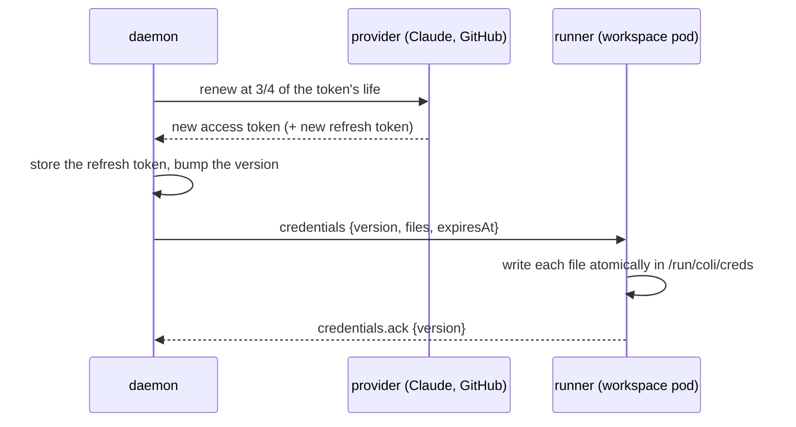

# Credentials and connections

Every user brings their own logins: Claude or Codex for the agents, GitHub for code, Linear for the
tracker. Nothing in the cluster acts as a shared user. Long-lived secrets stay in the user's daemon,
and the pods where agents run get short-lived tokens that the daemon keeps fresh.

## The rules

1. **Refresh tokens live only in the user's daemon.** Never in Kubernetes Secrets, never in a
   workspace pod, never sent to a UI.
2. **The daemon is the only thing that renews a token.** Linear and GitHub (and likely the agent
   CLIs) replace the refresh token on every renewal, so two renewers would invalidate each other.
3. **A workspace pod gets only the access tokens its kind of work needs**, and they expire on
   their own. A task's pod needs Claude (or Codex) and GitHub. Nothing ever needs Linear.
4. **A cluster daemon uses its own logins**, separate from the ones on your laptop, for the same
   reason as rule 2: your laptop's `claude` and the daemon renewing one login would log each other
   out. Single-user mode is unchanged: the daemon on your laptop uses your CLIs' logins, as now.
5. **Resident by default.** The daemon keeps refresh tokens so agents keep working while your
   laptop is closed. A *leased* mode, where the laptop keeps them and grants the daemon access
   tokens, is a possible later option, not part of this design.

## Connections

A **connection** is one login to one service. Each service is an adapter:

```ts
interface ConnectionAdapter {
  readonly service: 'claude' | 'codex' | 'github' | 'linear';
  /** start a login; the UI shows what comes back */
  login(): Promise<LoginPrompt>;          // a link to open, or a device code to type
  /** renew; called on a timer, never on demand from a pod */
  refresh(stored: StoredLogin): Promise<StoredLogin>;
  /** what a workspace pod needs, from the current access token — or nothing */
  forPod(stored: StoredLogin, need: PodNeed): PodCredentials | undefined;
  /** who this is, for :connections and for attributing actions */
  whoami(stored: StoredLogin): Promise<{ account: string }>;
}
```

| service | login | access token | refresh token | in a workspace pod? |
|---|---|---|---|---|
| **Linear** | OAuth app, authorization code through the gateway | 24h | replaced on each renewal | **never**: the daemon makes every tracker call |
| **GitHub** | GitHub App user token, device flow | 8h | 6 months, replaced on each renewal | **phase 1: yes**, for the clone and the agent's push and PR; [phase 2: clone only](#github-in-pods) |
| **Claude** | the CLI's own login, in the daemon's config dir | hours | long-lived | **yes**: the agent CLI needs it ([shipped, not proxied](#claude-and-codex)) |
| **Codex** | `codex login --device-auth`, in the daemon's `CODEX_HOME` | short | long-lived | **yes**, the same way |

### Linear

The org registers one Linear OAuth app. Each user authorizes it from `:connections`. Since April 2026
every Linear OAuth app issues 24-hour access tokens with rotating refresh tokens, and anything
created through a user's token is attributed to that user by default.

In a cluster, the authorization redirect lands on the gateway (`/v1/oauth/linear/callback`), which
hands the code to the daemon that started the login. The daemon exchanges it, so the gateway never
sees a token. The exchange needs the app's client secret, which identifies the app and can't act
as anyone. The operator copies it from the org's Secret into each user's namespace
([operator.md](operator.md#coliuser)). If Linear supports PKCE for this flow, the secret isn't
needed at all.

Single-user mode keeps `LINEAR_API_KEY` and the config-file key as they are. Signing in with OAuth
there would use a loopback redirect (`http://127.0.0.1:<port>/callback`) served by **the TUI**, on
the machine with the browser, which hands the code to the daemon over its connection. That works
whether the daemon is local or on a VM ([remote.md](../../docs/remote.md)), if the app allows a
loopback redirect.

### GitHub

**Every user signs in to GitHub themselves, from `:connections`, the same way as Linear.** Nothing
in colinear pushes, opens a PR or posts a review as anyone but the person whose work it is, and no
user's token is ever used for another user's work.

The sign-in is the device flow, the same "type this code at github.com/login/device" that
`gh auth login` uses. What it signs in to is a **GitHub App the org registers once**. The app is
not an identity. It acts as nobody on its own, and it doesn't hold anyone's access. It sets the
**ceiling** on what a user's token can do: the token acts as the user, but only within the app's
permissions, and only on repos where the app is installed.

- `contents: write`: push branches
- `pull_requests: write`: open draft PRs, post reviews
- `checks: read`, `actions: read`: CI status and logs

**Why not `gh auth login`'s own token.** It's the same per-user login, but through GitHub CLI's
OAuth app, and that gives a different token:

| | `gh auth login` | the org's GitHub App |
|---|---|---|
| whose token | yours | yours |
| lasts | until revoked | 8 hours, renewed by the daemon |
| reaches | every repo you can reach, with the classic `repo` scope | only the repos the app is installed on, within its permissions |
| in a workspace pod, if an agent leaks it | your GitHub, indefinitely | those repos, for hours |

Same user, much smaller blast radius. The cost is one app registration for the org.

**Single-user mode** keeps using `gh`'s own login by default, as now. `:connections` shows it (which
account, which host) so all your logins are in one place. Signing in to the org's app there instead
is optional, and only worth it with the container runner, where tokens go into containers.

### Claude and Codex

Agents run on the user's subscription, so the CLI in the workspace pod needs a credential. **It's
shipped, not proxied.** A subscription-backed Claude Code only routes through a proxy when
`ANTHROPIC_API_KEY` is set, which moves billing off the subscription, so a credential-injecting
proxy isn't an option.

What gets shipped is **the access token alone**:

| what could be shipped | lasts | an agent that leaks it gives away |
|---|---|---|
| the whole credentials file (access + refresh) | until revoked | the login, indefinitely; and the pod could renew it, logging the daemon out |
| a `claude setup-token` token | about a year | a year of the subscription |
| **the current access token** | hours | hours |

**The daemon renews by running the real CLI**, in its own config directory (`CLAUDE_CONFIG_DIR`,
`CODEX_HOME`), and copies the access token out of the file the CLI writes. That avoids building on
the CLIs' OAuth endpoints, which aren't documented APIs.

### What the spike found

Spike 0.1 ran on 2026-10-30 against Claude Code 2.1.314 on Linux, with a throwaway login
([the script](spikes/claude-credentials.md)). Every point below was observed, not assumed.

- **The file.** `$CLAUDE_CONFIG_DIR/.credentials.json` holds `claudeAiOauth` with `accessToken`,
  `refreshToken`, `expiresAt`, `refreshTokenExpiresAt`, `scopes`, `subscriptionType` and
  `rateLimitTier`.
- **Lifetimes.** An access token lasts **8 hours**. The refresh token lasts about 29 days beyond
  that.
- **An access token alone works.** With `refreshToken` removed from the file, the CLI runs, and it
  doesn't put one back. This is what pods get.
- **A stale `expiresAt` doesn't stop it.** Without a refresh token, the CLI sends the access token
  whatever `expiresAt` says, and the server decides. A late push costs nothing until the token is
  actually dead.
- **The file is re-read every turn.** In one long-lived process, a token corrupted between turns
  failed the next turn, and a good token put back made the following turn succeed. **A failed turn
  doesn't end the process.** So token sync is just replacing the file: no restart, no resume.
- **`claude auth status` renews.** Given a refresh token and a past `expiresAt`, it renews without
  starting a session: new access token, `expiresAt` 8 hours out. That's how the daemon renews.
  But **`auth status` is not a health check**: it reports `loggedIn: true` even when renewal failed.
  A renewal is confirmed by `expiresAt` moving, nothing else.
- **Renewal replaces the refresh token, and the old one stops working.** The old one then fails with
  "OAuth session expired and could not be refreshed". This confirms rule 2: one renewer.
- **Renewal revokes the previous access token.** That's immediate: a session holding it fails its
  next turn with "OAuth token revoked", and a new session can't even start ("couldn't verify your
  sign-in"; an org that manages settings checks them at start). See
  [the renewal window](#the-renewal-window).
- **`claude auth logout` revokes server-side.** A copied access token dies with it, so signing out
  in `:connections` actually takes the access away.

### The renewal window

Because renewing revokes the token every pod holds, there's a moment between the daemon renewing
and each runner acknowledging the new set when a turn can fail. In the spike, a turn that landed
in that moment failed with "OAuth token revoked", and the next turn after the push succeeded in
the same session.

So:

1. **Push straight after renewing.** The daemon renews, reads the new file, and pushes to every
   runner in the same step. The window is a round trip.
2. **The runner retries a turn the window broke.** If a turn ends in "OAuth token revoked" or a 401,
   and a newer credential set is on disk (or arrives within ten seconds), the runner sends the same
   turn again rather than reporting a failure. The process survives a failed turn, so this is a
   resend, not a restart. One retry; a second failure is real.
3. **Renew at three-quarters of the token's life**, as already planned, which with 8-hour tokens
   is about every 6 hours. The window opens a handful of times a day per user.

## Token sync

How a renewed token reaches every pod that needs it.



- **Renew early.** At three-quarters of the access token's life, not on a 401. A pod should never
  hold an expired token while a fresh one exists.
- **Push to every connected runner.** The `credentials` frame ([runner.md](runner.md#the-protocol))
  carries the complete set of files that runner needs, and a version. Only the newest version
  matters, so a runner that missed one doesn't need it replayed.
- **Write atomically.** Write to a temporary file in the same directory, then rename it, so a CLI
  never reads half a file.
- **Credentials before work.** A runner that connects (or reconnects) gets the current set first.
  `prepare` and `session.start` are refused until that set is acknowledged.
- **Only what the workspace's kind needs.** A task's or review's pod gets the agent runtime's token
  and GitHub; the scratch workspace gets the agent runtime's and GitHub for its read-only clones.
  `PodNeed` is decided by the workspace's kind. A GitHub user token can't be narrowed below the
  app's permissions, so a review's pod holds the same GitHub token a task's does; taking GitHub out
  of review pods is part of [phase 2](#github-in-pods).
- **Credentials before the clone.** `prepare` clones with the GitHub token, so a new runner gets
  its credentials first, and `prepare` waits for the acknowledgement.

### Where credentials land in a pod

`/run/coli/creds` is an in-memory `emptyDir`, so tokens are never written to the workspace's
volume. The CLIs are pointed at it:

- **Claude:** the agent config dir is on the volume (transcripts have to survive sleep), and its
  `.credentials.json` is a symlink into `/run/coli/creds`.
- **Codex:** `CODEX_HOME/auth.json` is a symlink, the same way.
- **GitHub:** `GH_CONFIG_DIR=/run/coli/creds/gh` for `gh`, and a git credential helper that reads
  `/run/coli/creds/git-credentials`.

Environment variables are avoided because a running process never sees a new one.

### When renewal fails

A revoked login, an expired refresh token, or a provider outage:

1. `:connections` shows the connection as broken, and why.
2. Before the current access token expires, each running task that depends on it is parked in
   `needs_input` with "reconnect Claude in :connections". That's a decision for the user, not a
   failure.
3. After you sign in again, `r` resumes as usual, with fresh credentials pushed first.

## GitHub in pods

Agents push their branches and open PRs themselves today (`git push`, `gh pr create` in the work
prompt), and the CI-fix prompt has them read logs with `gh`. So in phase 1 a task's pod gets the
user's 8-hour GitHub token. An agent that's been hijacked can use it for up to 8 hours, within the
app's permissions, on the repos where the app is installed.

Phase 2 takes GitHub out of agents' reach. The agent gets colinear tools instead:

- `push_branch` and `open_draft_pr`
- `ci_status` and `ci_logs`
- `pr_view`

Their handlers run in the daemon ([runner.md](runner.md#the-seam)), which uses the user's token, and
for the push asks the runner to run `git push` with a credential that exists only for that one
command. The clone in `prepare` works the same way. After that, no GitHub token sits in a pod
between commands. This matches how colinear already posts reviews: as a fixed call, not something an agent
claims it did. It changes the prompts, so it's a separate step in the work order.

## Storage

The daemon keeps logins in its state directory (`vault/`), on its own volume.

- **Cluster mode: envelope encryption.** Each login is encrypted with a data key, and the data key
  is wrapped by a KMS key. On EKS that's **one key for the install**, with each user's data keys
  bound to their namespace through the KMS encryption context. EKS Pod Identity tags each daemon's
  AWS session with its namespace, and the key policy allows a decrypt only when the two match. So no
  per-user IAM role is needed, only a Pod Identity association per namespace, which the operator
  creates. Reading the volume isn't enough to read the tokens, and one user's daemon can't decrypt
  another's.
- **Single-user mode:** files readable only by you, as today. The CLIs keep their own logins.

What this can't defend against: root on the node, or `exec` into the daemon pod, can read the
daemon's memory while it runs. That's audited, and it's the limit stated in the
[README](README.md#threat-model).

## `:connections`

A new view, daemon-backed:

```text
 service  account               status         expires    renewed
 claude   alice@example.com     ok             in 5h      12m ago
 github   alice                 ok             in 7h      40m ago
 linear   Alice                 ok             in 23h     1h ago
 codex    -                     not signed in
```

- `enter` signs in, or signs in again. It shows a device code or a link, with a spinner until the
  login completes.
- `x` signs out. The daemon forgets the login and revokes it where the provider allows.
- A warning in the header when a connection is broken or close to expiry with nobody able to renew it.

The UI never receives a token, only these rows.

## Open questions

- **The spike's three questions**, above. Everything about Claude and Codex in pods waits on them.
- **Linear PKCE.** If Linear supports it for this flow, the client secret isn't needed at all.
- **The KMS key policy.** Confirm that EKS Pod Identity's namespace session tag can be matched
  against the encryption context in a key policy, as [storage](#storage) assumes.
- **Revocation on sign-out.** GitHub and Linear support it. Do the Claude and Codex CLIs have a
  logout that actually revokes, or does it only delete the local file?
