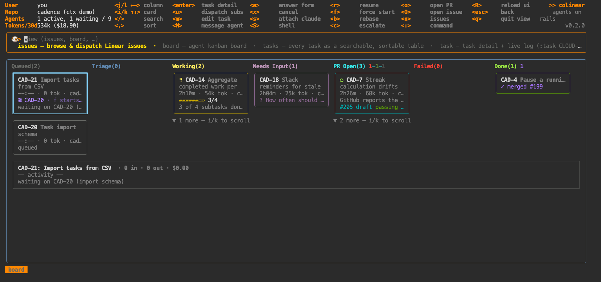

# colinear docs

- **[Demo mode](demo.md)** — `coli demo`: a populated board, no account, nothing billed
- **[Getting started](getting-started.md)** — install, configure, dispatch your first issue
- **[Security & blast radius](security.md)** — what colinear can touch, what it can't, where your data lives
- **[How dispatch works](dispatch.md)** — the triage → work → checks pipeline, messaging agents, sessions
- **[Configuration](configuration.md)** — every option and its default
- **[Remote daemon](remote.md)** — run the daemon on a VM, drive it over ssh *(work in progress)*
- **[Docker](docker.md)** — the daemon (and therefore agents) in a container *(work in progress)*
- **[CLI](cli.md)** — `coli`, `init`, `daemon`, `gc`, `contexts`, `doctor`
- **[Architecture](../DESIGN.md)** — how it works inside

## Views

`:` opens the command bar; tab completes. Most views also have a short alias.

<!-- generated: views (bin/gen-docs) -->
| view | aliases | what it's for |
|---|---|---|
| [`:issues`](views/issues.md) | `i` `is` | browse the tracker and dispatch agents |
| [`:board`](views/board.md) | `b` `bo` | agent kanban board |
| [`:task`](views/task.md) | `ta` | task detail + live log (:task CLOUD-123) |
| [`:projects`](views/projects.md) | `pj` `proj` | projects in the tracker |
| [`:project`](views/projects.md) | `p` | project kanban (:project NAME) |
| [`:plan`](views/plan.md) | `chat` | project planning chat (:plan PROJECT) |
| [`:reviews`](views/reviews.md) | `rev` `pr` | PRs awaiting my review + assisted pre-review |
| [`:todo`](views/todo.md) | `next` `agenda` `recs` | what to do next: reviews, waiting agents, deadlines, ranked |
| [`:jobs`](views/jobs.md) | `job` `j` `cron` | work asked of colinear directly, by hand or on a schedule, and what each run reported |
| [`:costs`](views/costs.md) | `cost` `$` | spend per ticket |
| [`:logs`](views/logs.md) | `log` `debug` | live debug log (what colinear is actually doing) |
| [`:diff`](views/diff.md) | `selfreview` | read a task's own branch before promoting its draft PR |
| [`:agents`](views/agents.md) | `ps` `tasks` `ls` `t` | every agent and task: what needs you, what is working, what waits |
| [`:family`](views/family.md) | `fam` `subs` | split work: every tracking parent and its sub-issue tasks |
| [`:gc`](views/gc.md) | `disk` | reclaim worktree disk and finished cards |
| [`:chan`](views/chan.md) | `channel` `irc` | coordination channels (experimental — :chan CLO-67) |
| [`:config`](views/config.md) | `cfg` | view & edit colinear config |
| [`:sessions`](views/sessions.md) | `sess` `claude` `codex` | your Claude Code and Codex conversations — enter resumes one |
| [`:theme`](views/theme.md) | `themes` `colors` | pick a colour theme, trying each as you move |
| [`:help`](views/help.md) | `h` | views, keys, custom view schema |
<!-- /generated -->

## Global keys

The line across the top is always there: who you are, how many agents are running (work, reviews,
jobs, plans and drafts alike) and how many need you, what they've cost over the retention window, and the context if it isn't the
default. The keys used to fill a four-row header there; they're behind `` ` `` now.

**Movement is `ijkl` everywhere,** laid out like the arrow keys: `i` up, `k` down, `j` left, `l` right.
That holds in every list, every scrolling pane and every popup, and on a form's choice rows `j`/`l`
step through the options. The arrow keys always work too.

| key | what |
|---|---|
| `:` | go to a view: a palette listing every view, narrowed as you type. `↑`/`↓` pick, `tab` completes, `enter` opens. An argument after the name still works (`:task CLO-142`) |
| `` ` `` | the keys for the view you're on, and the global ones, in a popup. `` ` ``, `esc` or `q` closes it |
| `@` | [ask colinear](#asking-colinear) to do something |
| `?` | help |
| `esc` | clear filters, then go back |
| `q` | back, or quit at the root |
| `R` | reload the frontend on new code — agents keep running |
| `\` | the [agent rail](views/agents.md#beside-every-view) beside every view |
| `ctrl+c` | quit |

## Asking colinear

`@` opens a chat with an agent that can run colinear. Ask it for something in your own words:
"find all PRs in the stack under owner/repo#123, add them to reviews and start a local review on each".
It works it out with the GitHub CLI and colinear's own tools, then says what it did. Its tools:

- `list_reviews` and `list_tasks`;
- `review_status` for one PR's review;
- `add_review`, which puts a PR on the review list;
- `start_review`, which starts colinear's local pre-review of a PR in the background, so it can start
  several and report back.

It never posts. Commenting, approving, merging and pushing stay keys you press, and it can't edit
files. It runs under your `agentPermissionMode` and `denyTools`, on Claude Code.

- **Messages and replies:** `enter` sends. A message typed while it's working waits its turn. The line
  above the input shows what it's doing right now.
- **Closing:** `esc` closes the chat and the agent keeps working. When it replies, a toast says so,
  and `@` shows the conversation again.
- **Starting over:** `ctrl-n` starts a new conversation; the one before is kept. `ctrl-x` stops the
  current one.
- **History:** every conversation is kept. `ctrl-o` lists them, newest first, with when each was last
  used and how long it is. `enter` opens one again, and the next message resumes its session, so
  the agent remembers it. A reply to a conversation you've moved away from still lands in that
  conversation. After a restart, the most recent one is open.

Conversations are saved in the state directory (`ask/conversations/`), so they survive the frontend
and the daemon restarting. Each message resumes
the same session, so "and the next one" means what you'd expect.

## Sorting

Every sortable view (the agents table, the board, `:issues`, `:projects`, `:reviews`, `:costs`)
sorts the same way. `,` opens the sort bar, which lists the columns in a row:

- **Pick a column:** `tab` or `←` `→` walks the columns, and typing jumps to one (`tok` lands on
  tokens).
- **Sort:** `enter` sorts by the column under the cursor. On the column that's already sorted, it
  reverses.
- **Choose a direction:** `↑` sorts ascending and `↓` descending, so a direction never takes two
  steps. `shift-enter` also reverses in terminals that report it; most send plain enter for it, which
  is why `↓` exists.
- **Leave:** `esc` closes the bar without changing anything.

The sorted column's header carries ↑ or ↓. The old keys (`s` in `:issues`, `:projects` and
`:costs`, `S` in `:reviews`) open the same bar.
