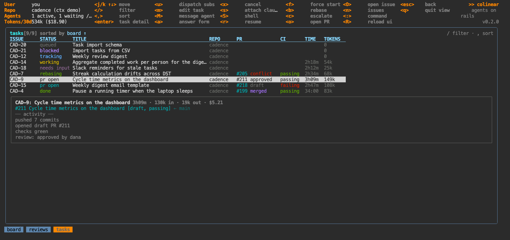

# `:agents` — every agent and task, by whose move it is

Aliases: `ps`, `tasks`, `ls`, `t`. No argument.

Every agent and every dispatched task, in the order it wants you. Sessions belong to four different
things — a task, a review, a project plan, a one-off draft — and a task outlives its sessions: an agent
that failed, opened a draft PR or was interrupted has stopped, but the task is still waiting on
someone. This lists it until it is done, under whoever that someone is.

```
  WORKING ON        KIND         FOR   DOING                         ┌──────────────────────────────────────────┐
needs you 1                                                           │ CLO-198 make the retry backoff configur… │
? CLO-203           question     2m    which retry policy should…     │ draft · dispatch · ran 12m · your move … │
your move 2                                                           │ pr open · PR #412 draft · CI passing · … │
! CLO-190           failed       1h    failed: rate limited twice…    │                                          │
! CLO-198           draft        3m    draft #412 ready · v reads…    │ next: draft #412 ready · v reads it, th… │
working 2                                                             │ ✓ PR #412 opened, CI running             │
⠙ CLO-211           work         4m    ⚒ Bash cargo clippy -p conn    │                                          │
⠹ colinear#162      review       1m    ⚒ Read src/core/codesearch.ts  │ last 3 of 3 steps                        │
waiting 3                                                             │ ⚒ Bash cargo test -p conn                │
· CLO-185           review       2h    #401 awaiting review           │                                          │
· CLO-180           blocked      10m   blocked by CLO-175 · f star…   │                                          │
· CLO-177           queued       10m   queued for a free agent        │                                          │
done 2                                                                │                                          │
✓ make the retry b… draft-issue  now   created CLO-214                │                                          │
✓ CLO-170           done         20m   merged #399                    │ enter opens it · every board key works … │
                                                                      └──────────────────────────────────────────┘
```

| group | what is in it |
|---|---|
| **needs you** | an agent that asked a question. Its session has *ended* — it is over until you reply — so these come from the tasks and reviews holding a question, longest-waiting first. |
| **your move** | stopped on something only you can do: failed or escalated, interrupted by a restart, dispatched without an agent started, sub-issues proposed, a green draft PR to read and promote, changes requested, a conflict, red CI, an approved PR to merge, a pre-review ready to post. |
| **working** | an agent is running on it right now, longest-running first. KIND is the session's: work, triage, maintenance, review, plan. |
| **waiting** | somebody or something else moves next: a blocker, a reviewer, CI still running, a free slot in the queue, sub-issues a tracking parent is waiting on. |
| **done** | tasks finished in the last hour, and sessions with no task behind them — a plan, a draft — for ten minutes after they end, with their outcome. |

The line on a parked row is the next step, with the key that takes it where there is one — `r`
resumes, `v` reads the diff, `b` rebases, `f` starts a blocked task anyway. One row per thing being
worked on, and it keeps its place under the cursor as it moves between groups.

A label in **bold** has something you have not seen: a question asked, a session started, a task
stopped after you last opened it. Opening it — `enter` here, or from anywhere else — is what counts
as looking.

The pane on the right (below, on a narrow terminal) is the selected row in full: what started it,
for how long, the task's status, PR, CI and [what it has changed](board.md#what-it-has-changed), the
next step, its model and spend, its question with the options, the last of what it has been doing,
its worktree and a ready-to-paste `claude --resume`.

| key | what |
|---|---|
| `j` `k` / ↑ ↓ | move · `g` top · `G` bottom |
| `enter` | open whatever owns it — the task, the review, the plan |
| `t` | switch to [the table](#the-table) and back — remembered, like the board's layout |
| everything else | on a task's row, identical to the [board](board.md#keys): `a`, `1`–`9`, `M`, `s`, `S`, `r`, `f`, `v`, `b`, `x`, `o`, … |

On a review's row, `a` takes you to the review to answer it there, where its context is.

## The table

`t` swaps the groups for every task as one searchable, sortable table — the board's data without the
board's geometry, with the columns the grouped list has no room for. This was `:tasks`; its names
open this view.



`CHANGE` is [what the worktree has changed](board.md#what-it-has-changed) — `+added -removed`, then
`~n` for files not committed yet — and turns amber when a working agent has edited nothing for twenty
minutes. Default order is the board read left-to-right: column, then what needs you first. `,` opens
the [sort bar](../README.md#sorting): `tab` to a column, `enter` to sort, `↑` `↓` for direction, `/` filters with the same matcher the board uses —
id, title, repo, status, PR state, CI. The selected task's detail pane sits below the table when the
terminal is tall enough. Every board key works on the selected row.

## Beside every view

**`\`** puts the same list in a rail down the left of every view — two rows an agent, what it is on
and for how long, then what it is doing, bold where there is something new. It keeps what might need
you now: questions, your move, working, and what finished in the last ten minutes. What is waiting on
somebody else stays here. It answers "what is going
on" without leaving the view you are in; this page is where you act on it.

```
╭ agents · 3 new · \ hides ─╮
│ needs you                 │
│ ? CLO-203              2m │
│   which retry policy sho… │
│ your move 2               │
│ ! CLO-190 failed       1h │
│   failed: rate limited t… │
│ ! CLO-198 draft        3m │
│   draft #412 ready · v r… │
│ working 2                 │
│ ⠙ CLO-211 work         4m │
│   ⚒ Bash cargo clippy -p… │
│ done                      │
│ ✓ make the ret… dr…   now │
│   created CLO-214         │
╰───────────────────────────╯
```

It needs a terminal 150 columns wide, and steps aside when a view goes full screen (the annotated
diff) and here on `:agents`, which is the same list with room to act. The view beside it is told the
terminal is narrower by the rail's width, so every view lays itself out as it would on a smaller
screen. Whether it is on is remembered, like the board's layout.

## Drafts

`n` in [`:issues`](issues.md) or [`:projects`](projects.md) starts a drafting agent, and those used
to run inside the TUI: closing the progress popup left it invisible, and reloading the UI (`R`) or
quitting killed it outright. They run in the daemon now, like every other agent. `esc` closes the
popup, not the session — the draft keeps going, it appears here, and the toast still lands when the
issue is filed.
