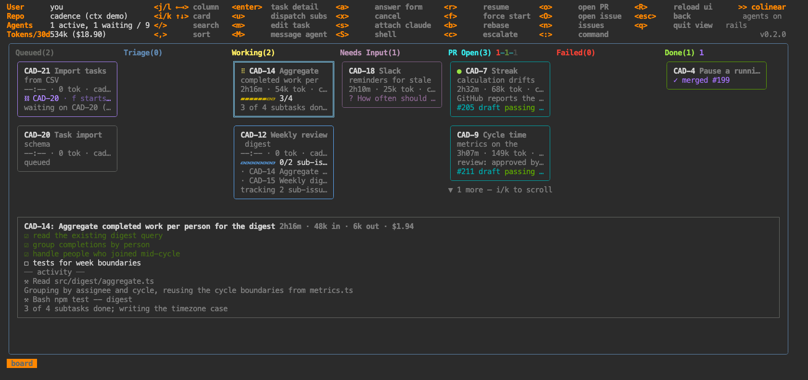

# `:board` — the kanban

Aliases: `b`, `bo`. Every dispatched task, in the column that says what it's waiting on.

Columns are Queued · Triage · Working · Needs Input · PR Open · Failed · Done. Within a column cards
sort by what wants you first — changes requested, conflicting, approved, draft, awaiting review — and
the header carries a coloured count per state (`PR Open(7) 1-1-2-2-1`): pink changes-requested, red
conflicting, green approved, grey draft, orange awaiting, purple merged, red closed.

A card shows live duration, tokens, [what the worktree has changed](#what-it-has-changed), repo, subtask progress, its question if it has one, blocked-by
chains, checks, and each PR with CI and review state. A **blinking dot** means a maintenance session
is running on an already-open PR — green rebasing, amber fixing CI — rather than the feature being
rewritten. Green is a rebase, amber a CI fix, and a `revise` dot means it is working through your review of the branch ([`:diff`](diff.md)).

## What it has changed

While an agent works, the daemon reads its worktree every fifteen seconds and the card carries the
result: **`+84 -12 ~2`** — lines added and removed against where the branch left the default
branch, and how many files are **not committed yet**. Uncommitted and untracked work counts, because
mid-session that is most of what an agent has done; the review document does not, because it is
yours. Measuring is read-only — it never touches the index the agent is using.

**`no edits 23m`**, in amber beside the clock, means the agent has been working for twenty minutes
without its worktree moving. Usually it is reading, testing or going in circles; the card is saying
it is worth a look, not that anything is wrong. The clock restarts whenever an agent starts on the
task, so resuming one that sat idle overnight does not read as stalled.

The detail pane spells it out — files, what is committed, when it last moved — and
[`:agents`](agents.md#the-table)' table has it as the `CHANGE` column, sortable by size. Once the agent stops, the
count is taken once more and kept: the card's last word is what the agent left.

## Keys

| key | what |
|---|---|
| `j` `l` / ← → | sideways — between columns, or between cards when [transposed](#transposing-the-board) |
| `i` `k` / ↑ ↓ | up and down — between cards, or between statuses when transposed |
| `t` | [transpose](#transposing-the-board): statuses become rows, cards run sideways |
| `/` | search — id, title, repo, status, PR state, CI. `/conflict`, `/needs`, `/failing` |
| `,` | sort within columns — the [sort bar](../README.md#sorting) |
| `enter` | [task detail](task.md) |
| `a` | answer the agent's question ([the form](task.md#answering-questions)) |
| `1`–`9` | pick an option outright, when there's only one question |
| `m` | edit the task — repo, pinned PR, instructions, model, triage, auto-rebase, auto-dispatch |
| `M` | message the agent without attaching — a multi-line box; `ctrl+d` sends, `ctrl+q` queues without waking |
| `u` | dispatch this parent's sub-issues (picker) |
| `s` | attach `claude` in the worktree · `S` a plain shell |
| `x` cancel · `r` resume — or start the agent on a [manually dispatched](../dispatch.md#manual-dispatch-a-worktree-no-agent) task · `f` force-start a blocked task · `b` rebase a conflicting PR |
| `c` | post the triage escalation to the tracker |
| `o` open the PR · `O` open the issue · `n` back to issues |

The board and [`:agents`](agents.md) do the same things with the same keys; only movement differs.

## Transposing the board

`t` turns the board on its side: each status becomes a full-width row and its cards run sideways.
The seven narrow columns become one wide lane per status, so a crowded status shows six cards at
once on a wide terminal instead of two — and a status with nothing in it collapses to a single grey
line rather than holding a column open.

The keys keep their directions. Sideways always moves the cursor sideways, so `j`/`l` walk the cards
in a status and `i`/`k` change status; empty statuses are skipped either way.

Only whole rows are drawn — a row is as tall as its tallest card, and Ink overflows rather than
clips, so half a row would paint over the detail pane. Expect two or three statuses on screen at a
time, with `▲`/`▼` counts for the rest. A row with more cards than fit says so in its header
(`PR Open(9) 2-1-1 · 1-6 of 9, j/l scrolls`) and scrolls as you walk into them.

The choice is remembered: the daemon stores it, so it survives `R`, a restart, and a reconnect.
